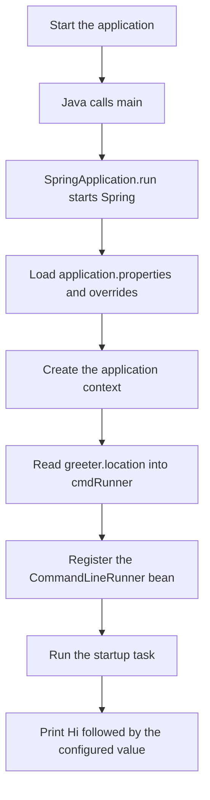

# Java greeting demo with Spring Boot

A small beginner-friendly **console application** for learning how Java and Spring Boot work together. When it starts, it reads a value from a configuration file and prints a greeting:

```text
Hi Kashif
```

Spring also prints startup logs, so the greeting will not be the only output. This project has **no website, REST API, database, or embedded web server**. It is a starting point for learning configuration and startup tasks, rather than a complete production application.

## Languages and technologies

| Technology | Version in this project | What it does |
| --- | --- | --- |
| Java | Java 8 (`1.8`) target | The programming language used for the application and tests. A JDK includes the compiler and runtime. |
| Spring Framework | Managed by Spring Boot | Creates and connects managed objects, called **beans**, in an **application context**. |
| Spring Boot | `1.5.3.RELEASE` | Configures Spring automatically based on the dependencies and starts the application. |
| Maven | Wrapper uses `3.5.0` | Downloads libraries, compiles Java, runs tests, and packages the application. |
| Spring Boot Actuator | Managed by Spring Boot | Adds monitoring support. This project does not include the web stack needed to expose HTTP monitoring endpoints. |
| JUnit | JUnit 4, managed by Spring Boot | Runs the startup smoke test with Spring's test integration. |
| XML | Maven POM format | Describes dependencies, project metadata, and build settings in `pom.xml`. |
| Java properties | `.properties` format | Stores configuration as `key=value` entries. |
| Shell / Windows batch | Wrapper launchers | Starts the project's Maven version on Unix-like systems or Windows. |

**Legacy version warning:** Spring Boot 1.5.3 and Maven 3.5.0 are old, unsupported versions. Use a JDK 8 for this existing example; do not assume that a current JDK will work with this old stack. For a new or production application, plan an upgrade to supported Java, Spring Boot, and Maven versions. This update keeps the existing dependency versions and intended greeting behavior. It also fixes the missing closing `}` in the original `@Value` property placeholder so Spring can resolve `greeter.location` correctly.

## Project layout

```text
.
├── pom.xml                         Maven dependencies and build configuration
├── mvnw                            Maven wrapper for Linux/macOS/Git Bash
├── mvnw.cmd                        Maven wrapper for Windows
├── .mvn/wrapper/                    Wrapper JAR and Maven download settings
└── src/
    ├── main/
    │   ├── java/d/kash/training/
    │   │   └── DemoApplication.java Application entry point and greeting task
    │   └── resources/
    │       └── application.properties Greeting configuration
    └── test/java/d/kash/training/
        └── DemoApplicationTests.java Spring startup smoke test
```

`src/main` contains the application. `src/test` contains tests, which are not included as application code in the executable JAR. Maven creates build output in `target/`.

## How startup works



### Understanding the Java code

- `package d.kash.training` groups the application's classes under a namespace. Its directory path mirrors the package name.
- `main(String[] args)` is the Java entry point. `args` holds arguments provided when launching the program.
- `@SpringBootApplication` enables Spring Boot configuration and component scanning in this package and its subpackages. An **annotation** is metadata beginning with `@` that a framework can interpret.
- `SpringApplication.run(...)` creates the Spring application context and runs startup tasks.
- `@Bean` tells Spring to manage the object returned by `cmdRunner(...)`. You do not call this method yourself to start the task.
- `@Value("${greeter.location}")` asks Spring to look up the configuration key `greeter.location` and pass its value into the method. The value is required; startup fails if it cannot be resolved.
- `CommandLineRunner` is an interface for work that should run after Spring has initialized.
- `args -> System.out.println(...)` is a Java 8 **lambda expression**: a compact implementation of the runner's single method. These `args` belong to the startup runner.
- `"Hi " + greeterLocation` joins two strings, and `System.out.println(...)` prints the result to the console.

Although the property is named `greeter.location`, its value can be a person's name or a place. The example uses `Kashif`.

## Prerequisites

1. Install a **Java Development Kit (JDK) 8**, not just a Java runtime.
2. Set `JAVA_HOME` to the JDK installation directory and make its `bin` directory available on `PATH`.
3. Open a terminal in this project's root directory, where `pom.xml` is located.
4. Verify that both commands report Java 8:

   ```text
   java -version
   javac -version
   ```

You do not need a separate Maven installation when using the included wrapper. The first build needs internet access to download Maven and dependencies from repositories. The wrapper's Maven distribution URL is configured in `.mvn/wrapper/maven-wrapper.properties`.

## Run, test, and build

### Windows PowerShell

```powershell
# Run the application directly from source.
.\mvnw.cmd spring-boot:run

# Run the tests.
.\mvnw.cmd test

# Compile, test, and create an executable JAR.
.\mvnw.cmd clean package

# Run the packaged application.
java -jar target/demo-0.0.1-SNAPSHOT.jar
```

In Windows Command Prompt, use `mvnw.cmd` instead of `.\mvnw.cmd`.

### Linux, macOS, or Git Bash

```sh
# Run the application directly from source.
./mvnw spring-boot:run

# Run the tests.
./mvnw test

# Compile, test, and create an executable JAR.
./mvnw clean package

# Run the packaged application.
java -jar target/demo-0.0.1-SNAPSHOT.jar
```

If the wrapper is not executable on Linux/macOS, run `chmod +x mvnw`, or invoke it with `sh mvnw test`.

The JAR filename comes from the artifact ID (`demo`) and version (`0.0.1-SNAPSHOT`) in `pom.xml`. `SNAPSHOT` means a development version that can change. Because this is a console app, there is no browser URL to open.

## Customize the greeting

Edit `src/main/resources/application.properties`:

```properties
# The name or place used in the greeting.
greeter.location=World
```

Restart the application to see `Hi World`. If running a packaged JAR, rebuild it with `clean package` after changing this source resource.

Alternatively, override the value without editing or rebuilding the application:

```sh
java -jar target/demo-0.0.1-SNAPSHOT.jar --greeter.location=World
```

Quote the whole argument if the value contains spaces:

```sh
java -jar target/demo-0.0.1-SNAPSHOT.jar "--greeter.location=New York"
```

Command-line properties take precedence over the value packaged in `application.properties`.

## What the test checks

`DemoApplicationTests.contextLoads()` is a **smoke test**: a quick check that the application can start.

- `@RunWith(SpringRunner.class)` connects JUnit 4 to Spring's test support.
- `@SpringBootTest` loads the application's Spring context with its configuration and startup runner.
- The empty test body is intentional: if context initialization fails, the test fails before the body runs.

This test does **not** assert the exact greeting text. A useful future exercise is to add a test that captures console output and verifies the greeting for a chosen configuration value.

## Troubleshooting

| Symptom | What to check |
| --- | --- |
| `JAVA_HOME is not defined correctly` | Point `JAVA_HOME` at a JDK 8 directory, not its `bin` subdirectory, and reopen the terminal. |
| `java` or `javac` is not found | Ensure the JDK's `bin` directory is on `PATH`. |
| A build fails on a recent Java version | Check `java -version` and `javac -version`; this legacy setup should be built with JDK 8. |
| Maven or dependency downloads fail | Check internet access, proxy settings, and repository access. Do not disable TLS checks to work around download errors. |
| `Could not resolve placeholder 'greeter.location'` | Restore the property in `application.properties`, or supply `--greeter.location=World` when launching the JAR. |
| `Unable to access jarfile` | Run `clean package` successfully first, then check the filename under `target/`. |
| No page appears at `localhost:8080` | Expected: this project has no web server or HTTP endpoints. |

## Suggested learning path

1. Run the application and find the greeting among the startup logs.
2. Change the property, restart, and observe the result.
3. Try a command-line override and compare it with the file value.
4. Read `DemoApplication.java` alongside the startup diagram.
5. Run the smoke test and learn how Spring initializes its context.

## Validation status for this documentation update

The test command `./mvnw test` was attempted, but the environment did not have a usable Java/JDK installation and the wrapper stopped with `JAVA_HOME is not defined correctly`. Tests and packaging could not be verified. Install/configure JDK 8 and run the commands above to validate locally.
